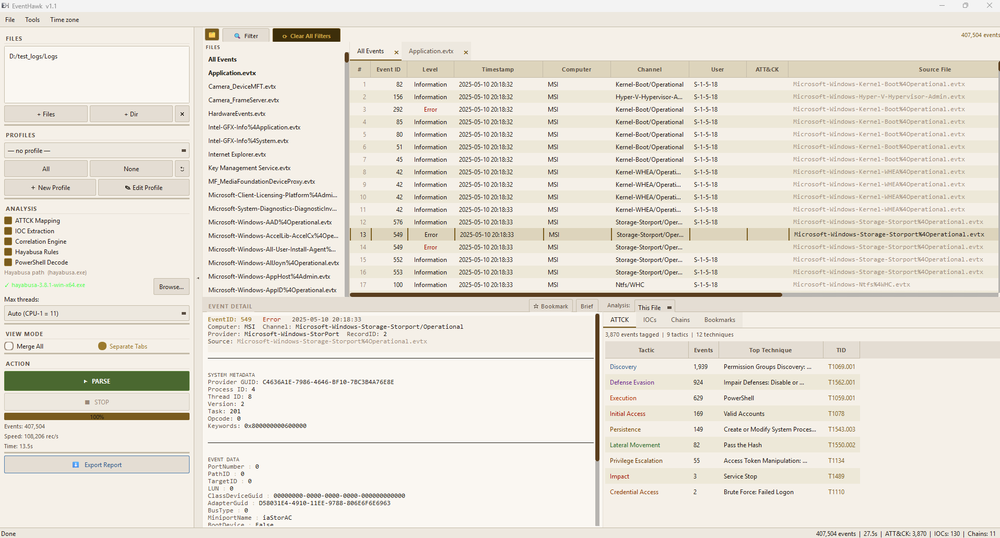

# GUI Overview

## What It Is

The EventHawk desktop GUI is a PySide6 (Qt6) application with a three-panel layout designed for DFIR workflows. Everything from file selection to threat analysis happens inside this single window.



---

## Layout

```
┌─────────────────────────────────────────────────────────────────┐
│  Menu Bar:  File  View  Analysis  Help                          │
├──────────────┬──────────────────────────────────────────────────┤
│              │  Toolbar: [Parse] [Filter] [Clear All] [Export]  │
│  LEFT PANEL  ├──────────────────────────────────────────────────┤
│              │                                                   │
│  • Files /   │  EVENTS TABLE                                    │
│    Folders   │  EID | Level | Timestamp | Computer | Provider   │
│              │  … rows …                                        │
│  • Profile   │                                                   │
│    selector  ├──────────────────────────────────────────────────┤
│              │                                                   │
│  • Analysis  │  EVENT DETAIL PANEL                              │
│    options   │  (Brief / XML view of selected event)            │
│              │                                                   │
│  • Stats     ├──────────────────────────────────────────────────┤
│              │  ANALYSIS TABS                                    │
│              │  [ATT&CK] [IOCs] [Chains] [Case]                │
└──────────────┴──────────────────────────────────────────────────┘
│  Status bar: N events | N filtered | Parse time | Mode         │
└─────────────────────────────────────────────────────────────────┘
```

---

## Panel Descriptions

### Left Panel

| Section | Purpose |
|---|---|
| **Files / Folders** | Add individual `.evtx` files or entire folders. Supports drag-and-drop. |
| **Profile selector** | Choose a DFIR profile to pre-filter events. Default: "All Events". |
| **Juggernaut Mode** | Checkbox — enables the columnar high-volume engine for 2M+ events. |
| **Analysis options** | Checkboxes for ATT&CK mapping, IOC extraction, correlation, Hayabusa. |
| **Hayabusa path** | Browse button to set the Hayabusa executable path. |
| **Statistics** | Live counters: total events, filtered count, parse duration. |

### Events Table (Centre Top)

The main table showing all parsed (and optionally filtered) events. Columns:

| Column | Content |
|---|---|
| EID | Windows Event ID |
| Level | Critical / Error / Warning / Information / Verbose |
| Timestamp | UTC timestamp (timezone adjustable) |
| Computer | Source hostname |
| Provider | Event provider (e.g. Microsoft-Windows-Security-Auditing) |
| User | Subject or target user SID / name |
| Channel | Log channel (Security, System, Application…) |
| Source File | Which `.evtx` file this event came from |

Click any column header to sort. Right-click a column header for the [Column Filter Popup](08-column-filters.md).

Right-click an event row for:

- **⚡ Quick Filter** on the clicked cell's value (= or ≠), and **Clear Quick Filters** — see [Quick Filters](07-quick-filters.md)
- **☆ Bookmark Event** / **★ Remove Bookmark**
- **⏱ Around this event** — the events within a time window on this machine or on all hosts, in a new tab — see [Around This Event](09c-around-this-event.md)
- **Copy Row as Text**

### Event Detail Panel (Centre Middle)

Shows the full content of whichever row is selected in the events table. Two view modes: **Brief** and **XML**. See [Event Detail Panel](05-event-detail-panel.md).

### Analysis Tabs (Centre Bottom)

Populated after parsing. Contains threat intelligence derived from the full event set. See [Analysis Tabs](09-analysis-tabs.md).

### Status Bar (Bottom)

Shows: total events loaded · events matching current filter · parse duration · active mode (Normal / Juggernaut).

---

## Launching the GUI

```bat
REM Double-click
EventHawk.exe

REM From source
py -3 evtx_tool.py gui
```

---

## Log Files

EventHawk writes its logs to **`%LOCALAPPDATA%\EventHawk\logs`** (usually
`C:\Users\<you>\AppData\Local\EventHawk\logs`). Open it with **Help → Open Log Folder**; error
messages that mention the log also give this path.

| File | Written by | What is in it |
|---|---|---|
| `eventhawk_gui.log` | the application | parses started and finished (file count, events, time), profiles applied, filters cleared, warnings and errors. Rotates at 5 MB, keeping 3 older files |
| `eventhawk_workers.log` | parse worker processes (both modes) | warnings and errors raised while parsing a file |
| `eventhawk_analysis.log` | the background analysis process | warnings and errors from IOC / correlation / Hayabusa analysis |
| `eventhawk_crash.log` | the application | low-level crash traces, if the program ever crashes |

Attach these files when you report a problem. They contain file names and counts from your case, so share
them only with people who may see the case. The command-line tool (`evtx_tool.py parse …`) writes its own log to
`evtx_tool_logs\evtx_parser.log` in the folder you run it from.

## Limitations

- The window layout is fixed — panels are not independently detachable.
- Column order is not currently user-rearrangeable via drag.
- Dark theme only in this version; light theme is on the roadmap.

---

## Related Docs

- [Normal Mode](03-normal-mode.md)
- [Juggernaut Mode](04-juggernaut-mode.md)
- [Event Detail Panel](05-event-detail-panel.md)
- [Advanced Filter](06-advanced-filter.md)
- [Analysis Tabs](09-analysis-tabs.md)
