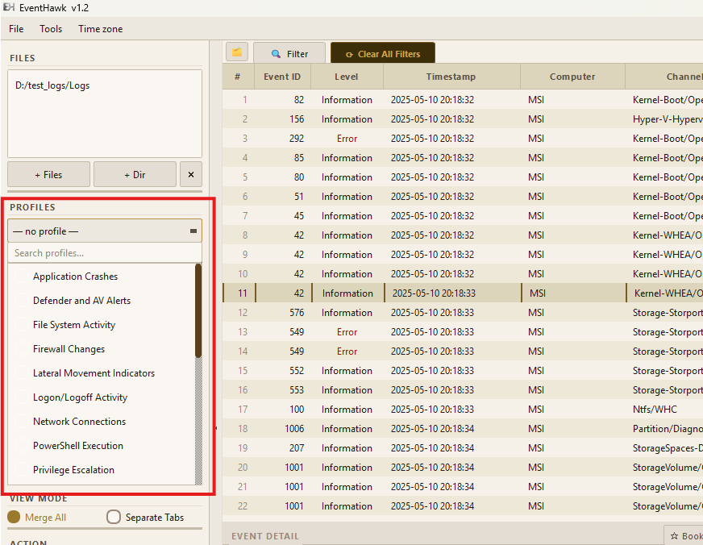
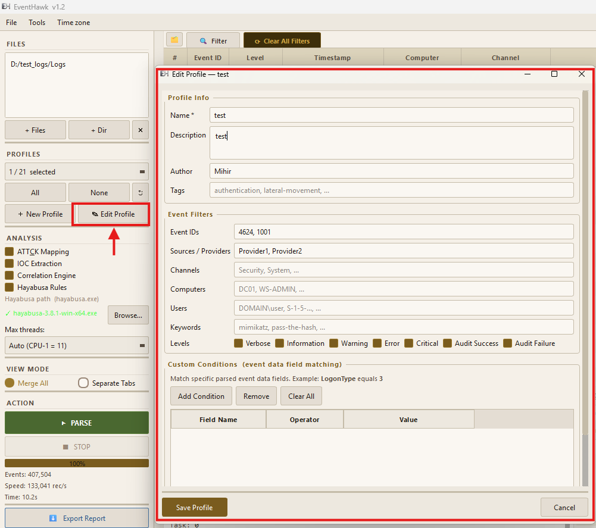

# DFIR Profiles

## What They Are

DFIR Profiles are pre-configured event filters that narrow the events you see to those relevant to a specific investigation type.

In the GUI a profile filters the **view**: every event is still parsed and loaded, so you can switch profiles, untick them or clear them at any time without re-parsing, and the Tools menu (Logon Sessions, WiFi History, Remote sessions, PowerShell History…) always works on every loaded event. In the CLI, `--profile` filters during parsing, which keeps only the matching events in the output.

---

## How to Apply a Profile

### In the GUI

1. Open the **Profile** dropdown in the left panel and tick one or more profiles.
2. Click **Apply Profiles** (or, before loading, just click **Parse**: the ticked profiles are applied as soon as the events are loaded).

The table then shows only the events matching the applied profiles (stacked with any Advanced Filter). Ticking a box on its own changes nothing until you click Apply Profiles.

To remove a profile: untick it (or click **None**) and click **Apply Profiles**, or click **Clear All Filters**, which also unticks every profile. Every loaded event comes back immediately, with no re-parse. Clearing only the Advanced Filter keeps the applied profiles.



### In the CLI

```bat
REM By profile name
py -3 evtx_tool.py parse C:\Logs --profile "Logon/Logoff Activity"

REM By profile file path
py -3 evtx_tool.py parse C:\Logs --profile C:\MyProfiles\my_profile.json
```

---

## Built-in Profiles

Sources are exact Windows provider names, and each profile lists only IDs those providers write, so a profile
never mixes in unrelated logs. The full ID list and a description of every ID are in each profile's JSON file in
`evtx_tool/profiles/defaults/`.

| # | Profile Name | Key Event IDs | Investigation Use Case |
|---|---|---|---|
| 01 | **User Account Management** | 4720, 4722, 4723, 4724, 4725, 4726, 4727, 4728 … (46 IDs) | Rogue accounts, password resets, group membership changes, lockouts |
| 02 | **Logon/Logoff Activity** | 4624, 4625, 4626, 4627, 4634, 4647, 4648, 4649 … (22 IDs) | Every logon and logoff; use the Logon type column to separate RDP, network and service logons |
| 03 | **Privilege Escalation** | 4672, 4704, 4705, 4717, 4718, 4728, 4732, 4756 … (9 IDs) | Admin-equivalent logons, user rights granted, members added to privileged groups |
| 04 | **RDP Activity** | 4778, 4779, 4825, 21, 22, 23, 24, 25 … (29 IDs) | Inbound RDP on the target, outbound RDP from the client, RD Gateway |
| 05 | **PowerShell Execution** | 400, 403, 500, 501, 600, 800, 4100, 4103 … (17 IDs) | Script blocks, module logging, engine and pipeline events, remoting |
| 06 | **Process Creation and Termination** | 4688, 4689, 4696, 1, 5, 25 | Every process start and exit (Security and Sysmon) |
| 07 | **Network Connections** | 5031, 5154, 5155, 5156, 5157, 5158, 5159, 3 … (9 IDs) | Connections and DNS queries (Windows Filtering Platform, Sysmon) |
| 08 | **File System Activity** | 4656, 4658, 4660, 4663, 4664, 4670, 2, 11 … (14 IDs) | File access, deletion, timestomping, alternate data streams |
| 09 | **Registry Modifications** | 4656, 4657, 4658, 4659, 4660, 4663, 4670, 12 … (10 IDs) | Registry value changes; Sysmon registry events can be very many |
| 10 | **Scheduled Tasks** | 4698, 4699, 4700, 4701, 4702, 100, 102, 106 … (23 IDs) | Task creation, changes, deletion and runs |
| 11 | **Service Install and Changes** | 4697, 7000, 7009, 7023, 7024, 7026, 7030, 7031 … (14 IDs) | Service installs (persistence, PsExec-style execution), crashes, state changes |
| 12 | **Defender and AV Alerts** | 1006, 1007, 1008, 1009, 1011, 1013, 1015, 1116 … (27 IDs) | Detections, ASR and network-protection blocks, protection turned off, exclusions |
| 13 | **Application Crashes** | 1000, 1001, 1002, 1026 | Crashes and hangs of applications, LSASS or security tools |
| 14 | **USB and Removable Media** | 6416, 6419, 6420, 6421, 6422, 6423, 6424, 1006 … (25 IDs) | USB disks with serial and model, device installs |
| 15 | **Firewall Changes** | 2002, 2003, 2004, 2005, 2006, 2009, 2010, 2011 … (25 IDs) | Firewall rule and setting changes, firewall service stopped |
| 16 | **Security Policy Changes** | 4715, 4719, 4739, 4817, 4864, 4865, 4866, 4867 … (16 IDs) | Audit, domain and trust policy changes |
| 17 | **Lateral Movement Indicators** | 4648, 4697, 4698, 4702, 5140, 5145, 7045, 1149 … (9 IDs) | Explicit-credential logons, remote services and tasks, admin shares, RDP and WinRM on the target |
| 19 | **Windows Update and Patch Activity** | 19, 20, 21, 22, 23, 24, 25, 26 … (16 IDs) | Patch level over time, failed or blocked updates |
| 20 | **System Boot and Shutdown Events** | 6005, 6006, 6008, 6009, 6013, 12, 13, 41 … (13 IDs) | Boots, shutdowns, crashes, sleep and resume, who restarted the machine |
| 21 | **Log Clearing and Anti-Forensics** | 1102, 104, 1100, 4719, 4906 | Event logs cleared, logging stopped, audit policy changed |
| 22 | **System Time Changes** | 4616, 1 | Clock changes that can mislead a timeline |
| 23 | **Kerberos and NTLM Authentication** | 4768, 4769, 4770, 4771, 4772, 4773, 4776, 4777 … (9 IDs) | Kerberoasting, AS-REP roasting, password spraying, pass-the-hash (domain controllers) |
| 24 | **Credential Access** | 4661, 4782, 4794, 5376, 5377, 4798, 4799 | SAM and password-hash access, DSRM, Credential Manager, account enumeration |
| 25 | **WMI Activity and Persistence** | 5857, 5858, 5859, 5860, 5861, 19, 20, 21 | WMI providers and event subscriptions (persistence) |
| 26 | **WinRM and Remote PowerShell** | 6, 91, 142, 161, 169, 8193, 8194, 8197 | WinRM sessions in and out, PowerShell remoting |
| 27 | **Active Directory Changes** | 5136, 5137, 5138, 5139, 5141, 4662, 4706, 4707 … (14 IDs) | Directory object changes, DCSync, trusts (domain controllers) |
| 28 | **Driver and Code Integrity** | 3001, 3002, 3003, 3004, 3033, 3034, 3076, 3077 … (10 IDs) | Unsigned or blocked drivers and images, WDAC |
| 29 | **BITS Jobs** | 3, 4, 5, 59, 60, 61, 16403 | BITS downloads and persistence, with URLs |
| 30 | **AppLocker and WDAC Blocks** | 8003, 8004, 8006, 8007, 8021, 8022, 8024, 8025 … (10 IDs) | AppLocker and WDAC blocks and audits |
| 31 | **WiFi Connections** | 8000, 8001, 8002, 8003, 11000, 11001, 11002, 11004 … (11 IDs) | Wireless networks joined and left (SSID) |
| 32 | **Printing** | 307, 300, 301, 316, 808 | Printed documents, printer drivers, spooler abuse |
| 33 | **Sysmon (All Events)** | all | Every Sysmon event |

---

## Creating a Custom Profile

Custom profiles are JSON files. Place them anywhere and reference them by path.

### Profile Schema

Profile fields sit at the top level of the JSON (this is the format of the built-in profiles in
`evtx_tool/profiles/defaults/`):

```json
{
  "name": "Persistence Mechanisms",
  "description": "Scheduled tasks, services, registry run keys, and startup items",
  "version": "1.0",
  "event_ids": [4698, 4699, 4700, 4701, 4702, 7045, 4697, 4657, 13],
  "sources": ["Security", "Service Control Manager", "Microsoft-Windows-Sysmon"],
  "channels": ["Security", "System", "Microsoft-Windows-Sysmon/Operational"],
  "keywords": ["schtasks", "sc create"]
}
```

**Fields that filter events:**

| Field | Type | Description |
|---|---|---|
| `event_ids` | int array | Event IDs to include. Empty = all IDs. |
| `sources` | string array | Provider / source names to include. Empty = all. |
| `channels` | string array | Log channels to include. Empty = all channels. |
| `computers`, `users`, `levels` | string arrays | Further restrictions, each applied only when non-empty. |
| `conditions` | array | Field conditions in the Advanced Filter format. |

Non-empty fields combine with AND. When several profiles are applied together, each keeps its own event IDs,
sources and channels: an event shows when it matches one of the applied profiles as a whole. One profile's
event ID never pairs with another profile's source. `computers`, `users`, `levels` and `conditions` apply to
every event.

**Fields that do not filter:**

| Field | Description |
|---|---|
| `name`, `description`, `version`, `author`, `tags` | Shown in the profile list and editor. |
| `keywords` | Words worth searching for in this kind of investigation. They are **not** used to filter events: a keyword list narrows the view to events whose text happens to contain one of the words, which on the test corpora hid most of the events each built-in profile selects (all of them for Lateral Movement). Use the search box or Advanced Filter text search to apply them. |
| `target_logs`, `severity_overrides` | Hints for which logs to load and how to rate events. |

### Load a Custom Profile

```bat
REM GUI: use the Browse button in the profile section of the left panel
REM CLI:
py -3 evtx_tool.py parse C:\Logs --profile C:\MyProfiles\persistence.json
```

### Validate a Profile

```bat
py -3 evtx_tool.py profiles validate C:\MyProfiles\persistence.json
```

---

## Profile Editor (GUI)

A built-in profile editor is accessible from **File → Profile Editor**. It provides a form-based interface for creating and editing profiles without hand-editing JSON.



---

## Limitations

- In the GUI, every event is loaded whatever profile is ticked, so a profile no longer reduces parse time or memory; use the CLI `--profile` option when you want only the matching events parsed.
- If `event_ids` is empty, all event IDs pass (no event ID filtering). This is intentional for channel-only or source-only profiles.
- `keywords` do not filter (see Profile Schema); search for them with the search box or the Advanced Filter.
- Custom profiles must be valid JSON. Use `profiles validate` to check before using.
- The GUI profile dropdown shows only profiles in the `evtx_tool/profiles/defaults/` folder and any profiles saved via the Profile Editor. Profiles loaded by path from CLI are not added to the dropdown permanently.

---

## Related Docs

- [CLI Mode — profiles command](12-cli.md#profiles--manage-dfir-profiles)
- [Advanced Filter](06-advanced-filter.md)
- [Normal Mode](03-normal-mode.md)
